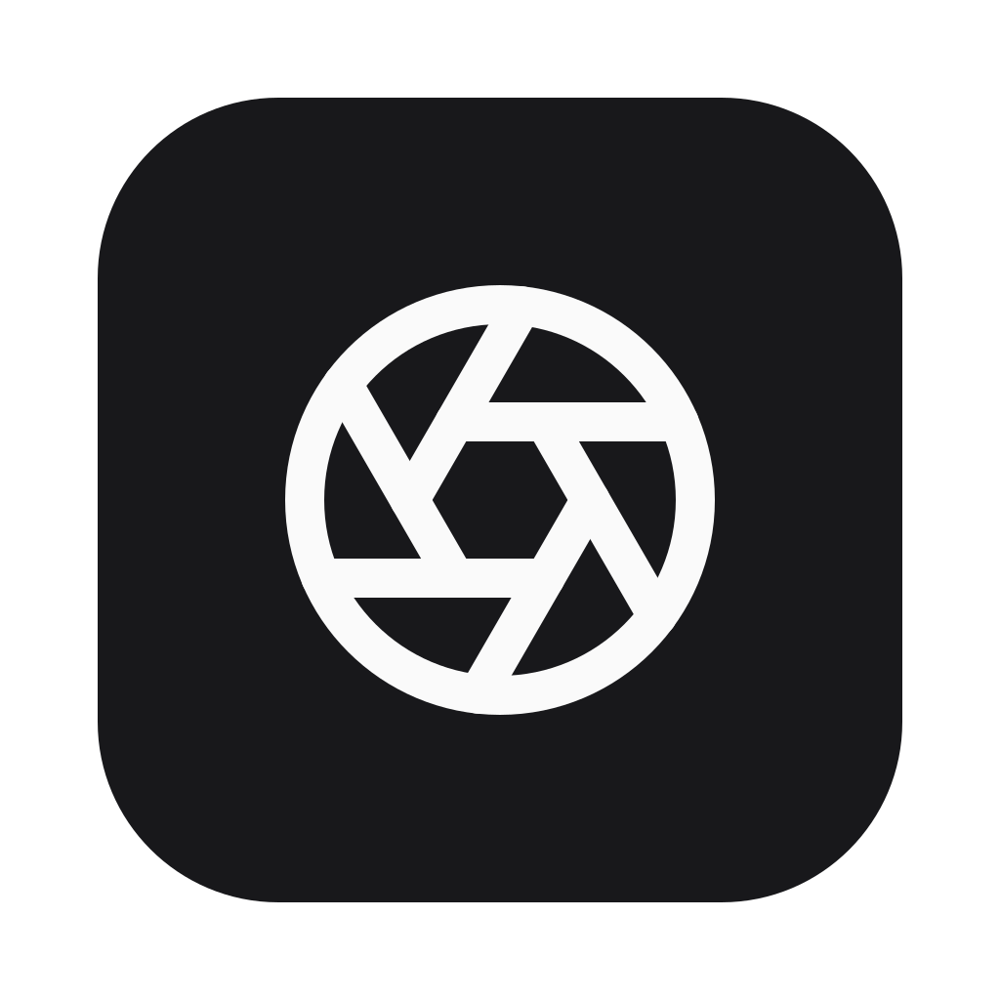
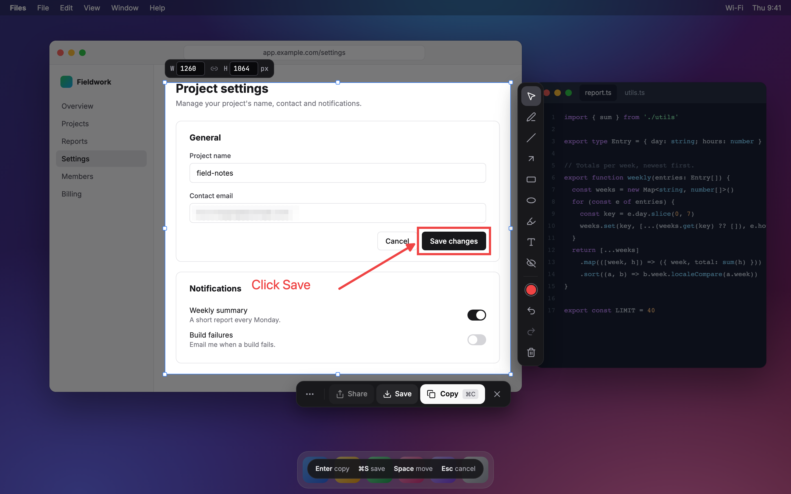
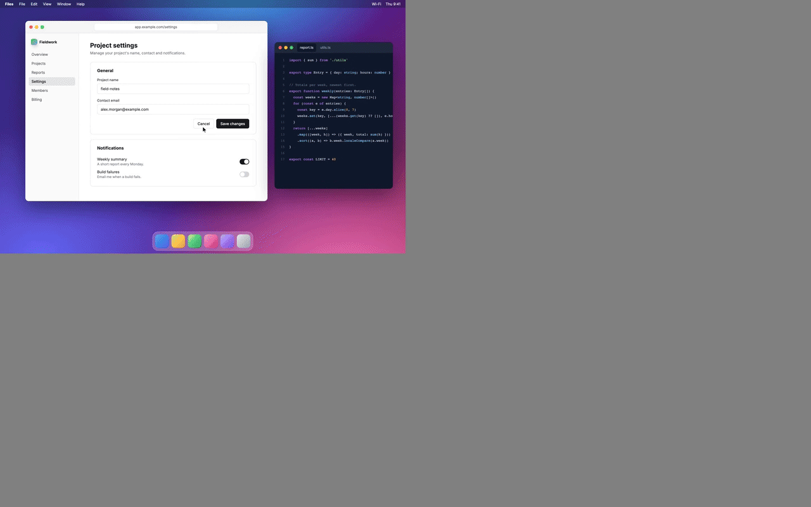
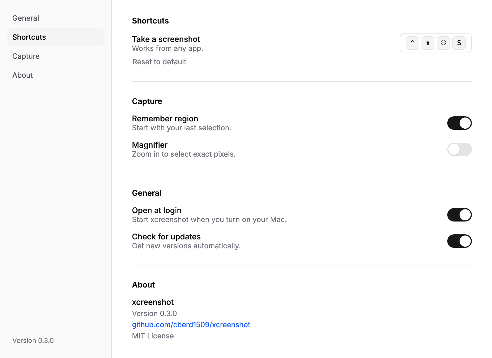

<div align="center">



# xcreenshot

**Fast, private screenshots for macOS and Windows.**
Press a shortcut, drag, annotate, done. Nothing ever leaves your computer.

[](https://github.com/cberd1509/xcreenshot/actions/workflows/ci.yml)
[](https://github.com/cberd1509/xcreenshot/security/code-scanning)
[](https://github.com/cberd1509/xcreenshot/releases)
[](LICENSE)
<br />
[](#install)
[](#install)
[](https://tauri.app)
[](https://www.rust-lang.org)
[](https://svelte.dev)
[](CONTRIBUTING.md)



</div>

## Features

- **One shortcut.** <kbd>⌃</kbd> <kbd>⇧</kbd> <kbd>⌘</kbd> <kbd>S</kbd> on macOS, <kbd>PrtSc</kbd> on Windows (<kbd>Ctrl</kbd> <kbd>Shift</kbd> <kbd>PrtSc</kbd> if Snipping Tool uses <kbd>PrtSc</kbd>). Change it anytime.
- **Drag to capture.** Select any part of the screen, across multiple monitors and Retina displays, pixel-exact.
- **Exact sizes.** Type a width and height, or lock the aspect ratio.
- **Remember region.** Reopen with your last selection, ready to go.
- **Annotate in place.** Arrows, lines, rectangles, circles, pen, highlighter, text and blur, in any color.
- **Copy, save or share.** Straight to the clipboard, a PNG file, or the system share sheet.
- **Private by design.** No accounts, no tracking, no uploads.
- **Tiny and native-feeling.** A small menu bar app, not a browser in disguise.

<p align="center">
  
</p>

## Install

> xcreenshot is in early development. The first release is on its way. ⭐ Star or watch the repo to hear about it.

**macOS** (14 Sonoma or later)

```sh
brew install --cask cberd1509/tap/xcreenshot   # coming soon
```

Or download the `.dmg` from [Releases](https://github.com/cberd1509/xcreenshot/releases).

**Windows** (10 or later)

```powershell
winget install bervex.xcreenshot   # coming soon
```

Or download the installer from [Releases](https://github.com/cberd1509/xcreenshot/releases).

## Usage

| Action                  | macOS                                                              | Windows                                                                                                       |
| ----------------------- | ------------------------------------------------------------------ | ------------------------------------------------------------------------------------------------------------- |
| Take a screenshot       | <kbd>⌃</kbd> <kbd>⇧</kbd> <kbd>⌘</kbd> <kbd>S</kbd>                | <kbd>PrtSc</kbd>, or <kbd>Ctrl</kbd> <kbd>Shift</kbd> <kbd>PrtSc</kbd> if Snipping Tool uses <kbd>PrtSc</kbd> |
| Copy                    | <kbd>⌘</kbd> <kbd>C</kbd> or <kbd>Enter</kbd>                      | <kbd>Ctrl</kbd> <kbd>C</kbd> or <kbd>Enter</kbd>                                                              |
| Save as PNG             | <kbd>⌘</kbd> <kbd>S</kbd>                                          | <kbd>Ctrl</kbd> <kbd>S</kbd>                                                                                  |
| Undo / Redo             | <kbd>⌘</kbd> <kbd>Z</kbd> / <kbd>⇧</kbd> <kbd>⌘</kbd> <kbd>Z</kbd> | <kbd>Ctrl</kbd> <kbd>Z</kbd> / <kbd>Ctrl</kbd> <kbd>Y</kbd>                                                   |
| Straight lines, circles | Hold <kbd>⇧</kbd> while drawing                                    | Hold <kbd>Shift</kbd> while drawing                                                                           |
| Cancel                  | <kbd>Esc</kbd>                                                     | <kbd>Esc</kbd>                                                                                                |

On first launch, macOS asks for **Screen Recording** permission. xcreenshot walks you through it.

> **Windows 11 tip:** to use <kbd>PrtSc</kbd> alone, turn off _Settings › Accessibility › Keyboard › Use the Print screen key to open screen capture_, then pick <kbd>PrtSc</kbd> in Settings.

<p align="center">
  
</p>

## Privacy

Your screenshots stay on your computer. xcreenshot has no accounts, no analytics and no telemetry, and it never uploads anything. The only network requests are update checks and downloads from GitHub Releases. Automatic update checks can be turned off in Settings. See [PRIVACY.md](PRIVACY.md).

## Build from source

You need [Node 26+](https://nodejs.org) (LTS), [pnpm](https://pnpm.io) and [Rust](https://rustup.rs) (plus Xcode Command Line Tools on macOS, or the [Tauri prerequisites](https://v2.tauri.app/start/prerequisites/) on Windows).

```sh
git clone https://github.com/cberd1509/xcreenshot.git
cd xcreenshot
pnpm install
pnpm tauri dev      # run in development
pnpm tauri build    # build the app
```

Release builds sign updates, so `pnpm tauri build` needs the signing key. To build without it, see [docs/updates.md](docs/updates.md#signing).

## Contributing

Contributions are welcome! Read [CONTRIBUTING.md](CONTRIBUTING.md) to get set up, and check the [issues](https://github.com/cberd1509/xcreenshot/issues) for something to pick up. Please follow the [Code of Conduct](CODE_OF_CONDUCT.md).

Found a security issue? Please report it privately; see [SECURITY.md](SECURITY.md).

## Acknowledgements

Built with [Tauri](https://tauri.app), [Svelte](https://svelte.dev), [shadcn-svelte](https://shadcn-svelte.com) and [Konva](https://konvajs.org). Icons from [Lucide](https://lucide.dev).

## License

[MIT](LICENSE) © 2026 [Bervex](https://github.com/cberd1509) and contributors
